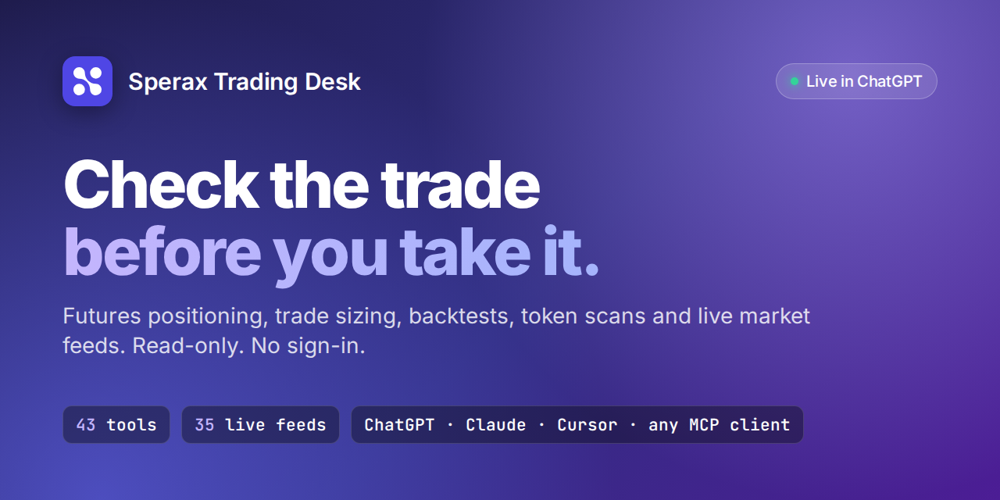

<p align="center">
  <a href="https://sperax-trading-desk.pages.dev/">
    <picture>
      <source media="(prefers-color-scheme: dark)" srcset="site/logo.svg">
      
    </picture>
  </a>
</p>

# Sperax Trading Desk — ChatGPT plugin

[](https://chatgpt.com/plugins/plugin_asdk_app_6aea0b5be6608191a02eeebc810e235c)
[](https://sperax-trading-desk.pages.dev/#install)
[](https://sperax-trading-desk.pages.dev/tools)
[](LICENSE)
[](https://sperax-trading-desk.pages.dev/)

Official Sperax Trading Desk plugin for ChatGPT, live in the
[ChatGPT plugin directory](https://chatgpt.com/plugins/plugin_asdk_app_6aea0b5be6608191a02eeebc810e235c).
Read-only crypto analysis: derivatives positioning, coin analysis, trade sizing, backtests,
token safety scans, swap quotes, wallet reviews and 35 live market feeds.

**Size, test and sanity-check** a trade idea against real numbers before acting on it
anywhere else. The plugin does not connect to exchange accounts, hold funds, place orders,
build transactions or sign anything, and needs no sign-in.

| | |
|---|---|
| Listing | [Sperax Trading Desk](https://chatgpt.com/plugins/plugin_asdk_app_6aea0b5be6608191a02eeebc810e235c) · developer Sperax · category Finance |
| Version | 2.0.0, live since 2026-11-17 |
| MCP endpoint | `https://chat.sperax.io/webapi/mcp/trading-copilot` (streamable HTTP, no auth) |
| Website | [sperax-trading-desk.pages.dev](https://sperax-trading-desk.pages.dev/) · <https://www.sperax.io> · <https://chat.sperax.io> |
| Tool reference | [All 43 tools with every parameter](https://sperax-trading-desk.pages.dev/tools) |
| Support | <https://chat.sperax.io/support> |
| Legal | [Terms](https://chat.sperax.io/terms) · [Privacy](https://chat.sperax.io/privacy) |

[](https://sperax-trading-desk.pages.dev/)

[Watch the 43-second launch video](launch-video/sperax-trading-desk-chatgpt.mp4)

## Try it

In ChatGPT, add **Sperax Trading Desk** from the plugin directory and ask:

- "Is Bitcoin perp funding crowded right now, and is there squeeze risk?"
- "Size a long on SOL at 150, stop 142, targets 165 and 180, risking 1% of a $10,000 account."
- "Backtest buying ETH when RSI drops below 30 and selling above 70 over the last 180 days."
- "Scan PEPE for honeypot risk, taxes and holder concentration."
- "Stress test 2 BTC, 20 ETH and 500 SOL through FTX and LUNA."

## Use it in other MCP clients

The same 43 tools work in any client that supports remote streamable-HTTP MCP servers. No key.

[](https://cursor.com/install-mcp?name=sperax-trading-desk&config=eyJ1cmwiOiJodHRwczovL2NoYXQuc3BlcmF4LmlvL3dlYmFwaS9tY3AvdHJhZGluZy1jb3BpbG90In0=)
[](https://insiders.vscode.dev/redirect/mcp/install?name=sperax-trading-desk&config=%7B%22type%22%3A%22http%22%2C%22url%22%3A%22https%3A%2F%2Fchat.sperax.io%2Fwebapi%2Fmcp%2Ftrading-copilot%22%7D)

**Claude Code**

```bash
claude mcp add --transport http sperax-trading-desk https://chat.sperax.io/webapi/mcp/trading-copilot
```

**Claude Desktop**: add a custom connector with the endpoint URL in Settings → Connectors, or
put this in `claude_desktop_config.json`:

```json
{
  "mcpServers": {
    "sperax-trading-desk": {
      "command": "npx",
      "args": [
        "-y",
        "mcp-remote",
        "https://chat.sperax.io/webapi/mcp/trading-copilot"
      ]
    }
  }
}
```

**Cursor** (`~/.cursor/mcp.json`):

```json
{
  "mcpServers": {
    "sperax-trading-desk": {
      "url": "https://chat.sperax.io/webapi/mcp/trading-copilot"
    }
  }
}
```

**VS Code** (`.vscode/mcp.json`):

```json
{
  "servers": {
    "sperax-trading-desk": {
      "type": "http",
      "url": "https://chat.sperax.io/webapi/mcp/trading-copilot"
    }
  }
}
```

**Windsurf** (`~/.codeium/windsurf/mcp_config.json`):

```json
{
  "mcpServers": {
    "sperax-trading-desk": {
      "serverUrl": "https://chat.sperax.io/webapi/mcp/trading-copilot"
    }
  }
}
```

**Gemini CLI** (`~/.gemini/settings.json`):

```json
{
  "mcpServers": {
    "sperax-trading-desk": {
      "httpUrl": "https://chat.sperax.io/webapi/mcp/trading-copilot"
    }
  }
}
```

**Codex CLI** (`~/.codex/config.toml`):

```toml
[mcp_servers.sperax-trading-desk]
url = "https://chat.sperax.io/webapi/mcp/trading-copilot"
```

[`server.json`](server.json) describes the server for the
[MCP Registry](https://registry.modelcontextprotocol.io) as `io.github.nirholas/sperax-trading-desk`.

## Tools

43 tools, all read-only (`readOnlyHint: true`, `destructiveHint: false`).

### Analysis (8)

| Tool | What it does |
|---|---|
| `get_derivatives_positioning` | Live perpetual-futures funding, open interest and long/short ratios from OKX and Hyperliquid for one coin, labelled crowded-long, crowded-short or neutral with squeeze risk |
| `analyze_coin` | Technical read from 200+ daily or 4-hour candles: EMA trend regime, RSI and MACD, volume, swing levels, ATR and structural stops, derivatives positioning, a scored verdict with reasons and a plan seed |
| `build_trade_plan` | Position size from account risk with fees, liquidation-vs-stop check, R-multiples, breakeven win rate, expectancy and half-Kelly |
| `backtest_signal_strategy` | RSI, moving-average, MACD and Bollinger Band rules on one to three coins over 30 to 365 days of daily candles, with fees, slippage and gas, against buy-and-hold and Bitcoin |
| `scan_token` | Token safety report for a symbol or contract: honeypot, taxes, mint and owner powers, holder concentration, liquidity and pair age, with a `safe` / `caution` / `danger` verdict |
| `compare_swap_quotes` | Live quotes for one trade from LI.FI, KyberSwap and Jupiter, ranked by output with price impact and gas. No links and no transaction data |
| `review_wallet` | Health check for a public EVM or Solana address: holdings, concentration, token approvals, safety scans of the largest holdings, crisis stress test and a `healthy` / `attention` / `at_risk` verdict |
| `stress_test_portfolio` | Replays `{symbol, valueUsd}` holdings through recorded crises (FTX, LUNA, COVID…) with drawdown, dollar loss, biggest losers and optional VaR / CVaR |

### Market feeds (35)

One tool per live data set. Each takes only the parameters its feed uses.

| Tool | Feed | Tool | Feed |
|---|---|---|---|
| `get_fear_greed_index` | `fear-greed` | `get_funding_rates` | `funding-rates` |
| `get_market_regime` | `market-regime` | `get_open_interest` | `open-interest` |
| `get_macro_dashboard` | `macro-dashboard` | `get_liquidations` | `liquidations` |
| `get_traditional_market_chart` | `tradfi-chart` | `get_long_short_ratios` | `long-short-ratio` |
| `get_crypto_stock_quotes` | `stock-quotes` | `get_options_overview` | `options` |
| `get_market_intelligence` | `market-intelligence` | `get_etf_flows` | `etf-flows` |
| `get_market_sentiment` | `sentiment` | `get_dex_volumes` | `dex-volume` |
| `get_global_market_stats` | `global-market` | `get_defi_overview` | `defi-overview` |
| `get_top_coins` | `markets-table` | `get_chain_tvl` | `chain-tvl` |
| `get_trending_coins` | `trending` | `get_top_defi_protocols` | `top-protocols` |
| `get_whale_alerts` | `whale-alerts` | `get_protocol_revenue` | `protocol-revenue` |
| `get_exchange_flows` | `exchange-flow` | `get_defi_yields` | `yields` |
| `get_tracked_wallet_activity` | `wallet-tracker` | `get_stablecoin_stats` | `stablecoins` |
| `get_gas_prices` | `gas` | `get_bridge_flows` | `bridges` |
| `get_bitcoin_network_stats` | `bitcoin` | `get_token_unlocks` | `token-unlocks` |
| `get_new_dex_listings` | `new-listings` | `get_governance_proposals` | `governance` |
| `get_crypto_news` | `news` | `get_onchain_ai_agents` | `erc8004-agents` |
| `get_sperax_protocol_stats` | `sperax` | | |

### Skills

| Skill | Flow |
|---|---|
| [`setup`](sperax-trading-copilot/skills/setup/SKILL.md) | Onboarding: account size, default risk, usual leverage and coins, then a first positioning check |
| [`pre-trade-check`](sperax-trading-copilot/skills/pre-trade-check/SKILL.md) | Token scan → coin analysis → positioning → trade plan with liquidation check |
| [`backtest-translation`](sperax-trading-copilot/skills/backtest-translation/SKILL.md) | Plain-language rule → backtest conditions → result against buy-and-hold |
| [`stress-test`](sperax-trading-copilot/skills/stress-test/SKILL.md) | Holdings list or wallet address → crisis replay with VaR in dollars |

## What it will not do

The plugin profile follows OpenAI's v1 directory rules:

- **No trade execution and no trade links.** The swap, perp, order and action link builders
  are not listed, and calling them returns JSON-RPC error -32602. Quote comparisons carry no
  DEX links or transaction data.
- **No diagnostics in responses.** Upstream source errors and internal timestamps are removed.
- **Blocked feeds.** Prediction markets, third-party social posts and internal service status
  (`predictions`, `ct-pulse`, `kol-leaderboard`, `tech-pulse`, `platform-status`,
  `service-status`) are not exposed.
- **No financial advice.** Market data is public and can be delayed or briefly unavailable.
  Backtests use daily candles only. Past performance does not predict future results.

## The MCP endpoint

`https://chat.sperax.io/webapi/mcp/trading-copilot` speaks MCP over streamable HTTP
(JSON-RPC over `POST`; `GET` answers 405). It needs no authentication.

| Profile | URL | Tools |
|---|---|---|
| Plugin (default) | `/webapi/mcp/trading-copilot` | The 43 read-only tools above |
| Full | `/webapi/mcp/trading-copilot?profile=full` | The 13 tools of the earlier Custom GPT, including link builders |

Each client IP may send 120 requests per 60 seconds. Over the limit the endpoint answers
429 with `Retry-After`. Responses are cached for 60 seconds to 15 minutes per argument set.

```bash
curl -s https://chat.sperax.io/webapi/mcp/trading-copilot \
  -H 'content-type: application/json' \
  -H 'accept: application/json, text/event-stream' \
  -d '{"jsonrpc":"2.0","id":1,"method":"tools/call","params":{"name":"get_fear_greed_index","arguments":{}}}'
```

Client setup is in [Use it in other MCP clients](#use-it-in-other-mcp-clients).

## Repository layout

```
.
├── sperax-trading-copilot/     # the plugin package uploaded to OpenAI as a ZIP
│   ├── plugin.json             # manifest: listing copy, review test cases, publication
│   ├── mcp.json                # remote MCP server declaration
│   ├── skills/                 # setup, pre-trade-check, backtest-translation, stress-test
│   └── assets/                 # logo and composer icon, light and dark
├── scripts/
│   ├── build.mjs               # validator and packager
│   ├── site.mjs                # website generator
│   └── lib/                    # shared MCP client
├── site/                       # Pages stylesheet and copy-button script
├── server.json                 # MCP Registry server description
├── glama.json                  # Glama MCP directory maintainers
├── tool-metadata.lock.json     # published tool contract (names, inputs, annotations)
├── launch-video/               # source and render of the launch video
├── docs/                       # runbook, launch kit and submission history
├── .github/                    # Pages workflow, issue templates, social preview
├── CITATION.cff                # citation metadata
├── CONTRIBUTING.md
├── SECURITY.md
├── LICENSE                     # Apache-2.0
└── NOTICE                      # trademark and third-party notices
```

## Development

Requires Node.js 20.11 or later.

```bash
npm ci
npm run check        # validate the package and the live tool contract
npm run build        # validate, then write dist/sperax-trading-copilot-<version>.zip
npm run update-lock  # accept the live tool contract into tool-metadata.lock.json
npm run site         # build the website into _site/
```

`scripts/build.mjs` checks the manifest, skills and assets against every limit in OpenAI's
plugin reference, then fetches `tools/list` from the MCP endpoint and checks every tool's
title, description, annotations and input schema. It fails the build when:

- a tool published in `tool-metadata.lock.json` was removed, renamed, lost an input or gained
  a required input, which would break the definition ChatGPT serves while an update is in
  review;
- listing copy, a skill or a tool description uses wording OpenAI review rejects (prediction
  markets, credits or upgrades, prefilled trade links, "best", "recommend", "guarantee") or
  names another AI assistant.

Point it at a staging server with `MCP_URL`:

```bash
MCP_URL=https://staging.example.com/webapi/mcp/trading-copilot npm run check
```

### Website

`scripts/site.mjs` builds [sperax-trading-desk.pages.dev](https://sperax-trading-desk.pages.dev/) from the live endpoint: the landing page with
install steps for every client, a reference page for all 43 tools generated from their input
schemas, schema.org structured data, Open Graph and X cards, `sitemap.xml`, `robots.txt`, a web
manifest, [`llms.txt`](https://sperax-trading-desk.pages.dev/llms.txt) and [`llms-full.txt`](https://sperax-trading-desk.pages.dev/llms-full.txt) for AI
assistants, `server.json`, and an MCP server card at
[`.well-known/mcp/server-card.json`](https://sperax-trading-desk.pages.dev/.well-known/mcp/server-card.json). The social card
and icons are rendered with Playwright Chromium (run `npx playwright install chromium` once).
`--social-preview` also writes `.github/social-preview.png`.

The site is hosted on Cloudflare Pages (project `sperax-trading-desk`). `npm run deploy` rebuilds
it from the live endpoint and uploads `_site/` with Wrangler. It reads `CLOUDFLARE_API_TOKEN`
(a token with Cloudflare Pages: Edit) and `CLOUDFLARE_ACCOUNT_ID` from the environment. The build
also writes `_headers`, which opens CORS on the discovery files and sets cache headers.
[`.github/workflows/pages.yml`](.github/workflows/pages.yml) publishes the same build as a
mirror on GitHub Pages; its canonical links point at Cloudflare.

### Packaging

The ZIP in `dist/` is what gets uploaded in the OpenAI plugin portal. The full submission,
review and maintenance process is in [docs/runbook.md](docs/runbook.md).

## Launch video

[`launch-video/`](launch-video/README.md) holds the 43-second 1920x1080 launch video and its
source: one HTML page with a deterministic `render(t)` function, rendered frame by frame with
Playwright, encoded with ffmpeg, and a soundtrack synthesized by `audio.py` from the same cue
timings. The tool cards show real responses from the live endpoint.

## Docs

- [Runbook](docs/runbook.md): live listing, architecture, setup, changing tools, changelog,
  troubleshooting.
- [Launch kit](docs/launch-kit.md): announcement copy for X, LinkedIn, Reddit, Hacker News
  and Product Hunt, and where to list the MCP server.
- [Submission checklist](docs/submission-checklist.md): OpenAI's review rules mapped to this
  plugin (historical, 1.2.0).
- [GPT-to-plugin gap analysis](docs/gpt-to-plugin-gap-analysis.md): how the Custom GPT became
  this plugin (historical, 1.2.0).

## Related

- [SperaxOS](https://chat.sperax.io): the AI agent workspace that hosts the MCP server. The
  server code lives in the SperaxOS repository and is the source of truth for tool behavior.
- [Sperax/speraxos-chatgpt](https://github.com/Sperax/speraxos-chatgpt): the earlier
  Trading Copilot Custom GPT, served by the same tools through REST Actions.
- [Sperax](https://www.sperax.io): USDs and the Sperax protocol.

## License

Code, manifest, skills and docs are licensed under the [Apache License 2.0](LICENSE). The
Sperax names and logos are trademarks and are not licensed; see [NOTICE](NOTICE). The fonts in
`launch-video/fonts/` are under the [SIL Open Font License 1.1](launch-video/fonts/OFL.txt).

Nothing this plugin returns is financial advice.

## Contributing and security

Bug reports and tool requests are welcome; see [CONTRIBUTING.md](CONTRIBUTING.md). Report
vulnerabilities privately as described in [SECURITY.md](SECURITY.md).
